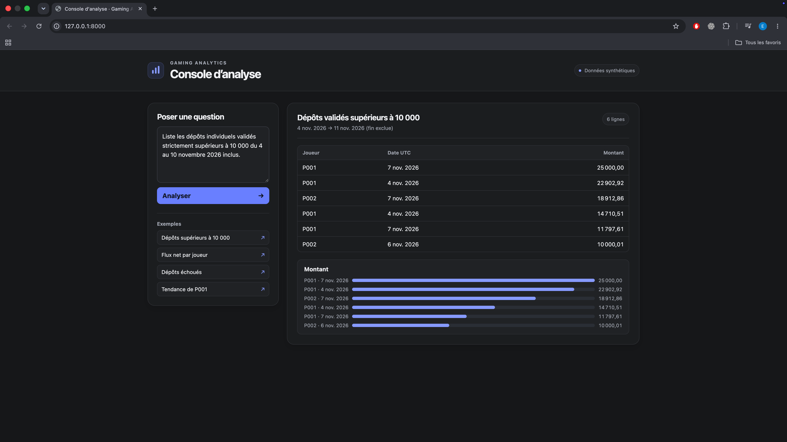
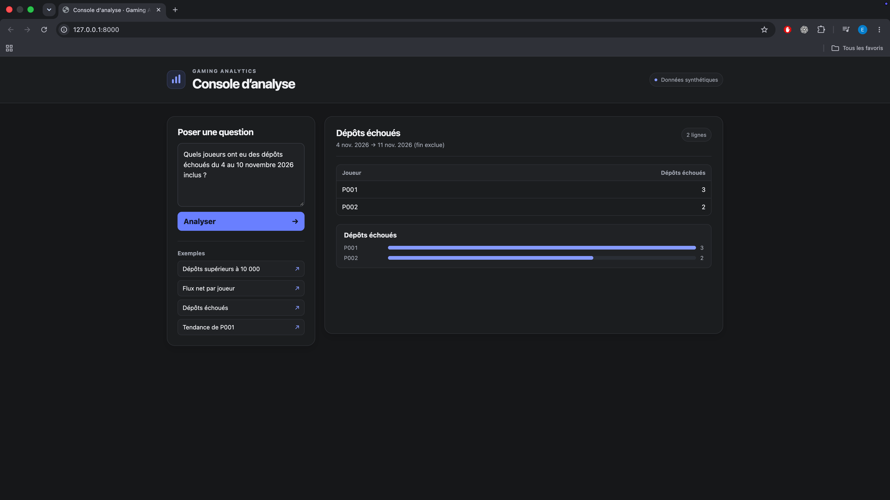
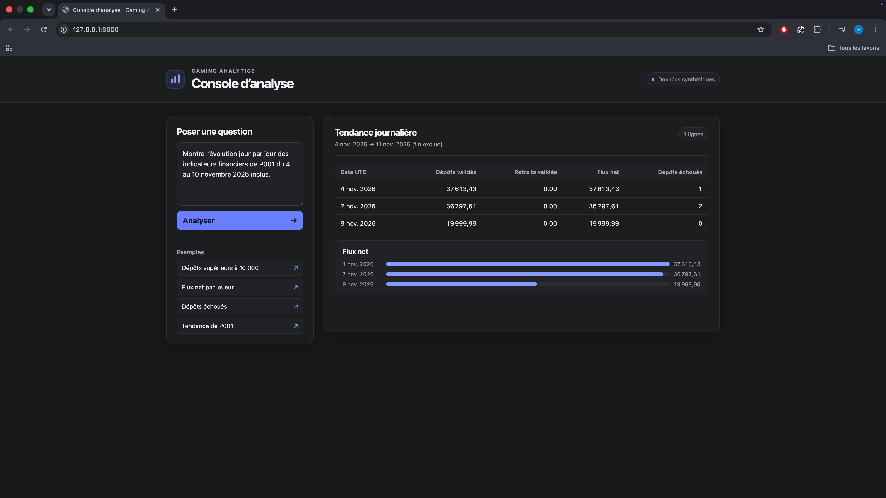

# Gaming Analytics Data Lake

## Pourquoi ce projet

Après **12 ans dans le secteur des jeux**, je souhaite me reconvertir vers les métiers de la **data, du cloud et de l’intelligence artificielle**. J’ai choisi un sujet proche de mon expérience pour relier des questions métier que je connais à de nouvelles compétences techniques.

Ce projet est pédagogique. Je l’ai conçu pour revoir mes fondamentaux SQL, pratiquer le *clean code*, mettre un premier pied dans le data engineering et apprendre à développer avec un agent de code, **Codex**. J’ai défini les cas métier, validé les choix d’architecture et confronté les résultats aux données de test à chaque étape.

J’ai aussi expérimenté le *harness engineering*, qui consiste ici à donner à l’agent un cadre de travail vérifiable. Le fichier [`AGENTS.md`](AGENTS.md) fixe les règles du dépôt. Ruff et pytest apportent des retours rapides, un test vérifie les frontières de l’architecture hexagonale et un lot synthétique sert de référence pour les tests de bout en bout sur AWS. [Présentation du harness engineering par OpenAI](https://openai.com/index/harness-engineering/)

## Le projet

Gaming Analytics Data Lake transforme des **transactions de jeu synthétiques** en indicateurs financiers. La **V1** construit et vérifie le pipeline de données, du CSV brut jusqu’aux tables interrogeables dans Athena. La **V2** ajoute une console locale où l’on pose une question en français et où l’on consulte les résultats en tableau et en graphique.

```text
CSV → S3 Bronze → Glue / PySpark → Silver Iceberg → SQL Athena → Gold Iceberg
                          └──→ Quarantaine S3

Navigateur → API Python → Bedrock propose un outil
                 └──→ Validation → Requête Athena sur Gold → Résultats JSON
```

| Couche | Responsabilité |
| --- | --- |
| **Bronze** | Conserver les CSV des joueurs et des transactions, organisés par lot. |
| **Silver** | Conserver la dernière version valide de chaque transaction dans Iceberg. Le `MERGE` s’appuie sur `transaction_id` et `updated_at`. |
| **Quarantaine** | Conserver les lignes rejetées, leur provenance et les motifs de rejet, en JSON Lines chiffré dans S3. |
| **Gold** | Publier les KPI financiers journaliers par joueur et une table de dépôts individuels validés. Les jours sont calculés en UTC à partir de la date de création. |
| **Agent** | Utiliser Claude pour sélectionner l’une des huit requêtes prédéfinies. Python valide les paramètres, exécute le SQL versionné et renvoie les données calculées par Athena. |

Le **flux net** correspond aux dépôts validés moins les retraits validés. Un dépôt au statut `failed` alimente le compteur d’échecs métier. Une ligne qui échoue aux contrôles de données va en quarantaine et laisse la dernière version valide en Silver.

## Démonstration

La console interroge le [lot synthétique de bout en bout](data/scenarios/transactions_e2e.csv), qui contient **15 dépôts de 40,00 à 25 000,00** entre le 4 et le 10 novembre 2026. Le lot comprend **10 dépôts validés** pour un total de **132 031,57**, et **5 dépôts échoués**.

### Dépôts validés strictement supérieurs à 10 000

L’agent retourne **six transactions**, de **10 000,01 à 25 000,00**. Le dépôt validé de 10 000,00 et les dépôts échoués au-dessus du seuil sont exclus. Le graphique reprend les montants du tableau.



### Dépôts échoués par joueur

Le classement affiche **3 dépôts échoués pour P001** et **2 pour P002**. Ces cinq lignes sont des transactions métier valides dans Silver.



### Tendance journalière de P001

La console montre les trois jours où P001 a eu une activité sur la période. Le graphique reprend le flux net journalier et le tableau détaille également les dépôts, les retraits et les échecs.



Les **huit outils** ont été vérifiés avec Claude et Athena en comparant les résultats à un calcul indépendant depuis le CSV. Le parcours **navigateur → API → Claude → Athena** a également été testé avec un résultat de six lignes, un résultat vide et une question hors catalogue.

## Technologies et choix d’architecture

| Technologie | Usage dans le projet |
| --- | --- |
| **Amazon S3, AWS Glue 5.0 et PySpark** | Stockage des lots, validation, quarantaine et traitement des transactions. |
| **Apache Iceberg, Glue Data Catalog et Amazon Athena** | Tables Silver et Gold, mises à jour transactionnelles et requêtes SQL. |
| **Amazon Bedrock, Claude Haiku 4.5 et Boto3** | Sélection d’outil à partir d’une question et appels AWS côté serveur. |
| **Terraform et IAM** | Modules d’infrastructure et permissions ciblées, dont le rôle Glue limité aux ressources utilisées. |
| **Python 3.13, uv, pytest et Ruff** | Backend, gestion des dépendances et vérifications locales. |
| **HTML, CSS et JavaScript vanilla** | Console sombre, formulaire, tableau et graphique, servis avec l’API locale. |

Le backend V2 suit une **architecture hexagonale**. Le domaine porte le catalogue et ses règles. Le cas d’usage `AnalyticsAgent.ask` dépend des ports `ToolSelector` et `QueryExecutor`. Bedrock et Athena implémentent ces ports, tandis que la CLI et l’API HTTP appellent le même cas d’usage. Cette séparation permet de tester les règles avec des doubles sans appeler AWS. [Code de l’agent](src/gaming_analytics_data_lake/agent/) · [Tests](tests/)

Les données et Athena restent à **Paris (`eu-west-3`)**. Le client Bedrock appelle **Stockholm (`eu-north-1`)** via le profil d’inférence européen Claude Haiku 4.5, qui peut traiter la demande dans ses régions européennes de destination. Les identifiants AWS restent côté serveur. Les buckets bloquent l’accès public, les résultats Athena sont chiffrés, et la configuration AWS locale, les plans et l’état Terraform sont exclus de Git. [Profil Claude Haiku 4.5 sur Bedrock](https://docs.aws.amazon.com/bedrock/latest/userguide/model-card-anthropic-claude-haiku-4-5.html)

## Problèmes rencontrés et corrections

| Problème | Correction et vérification |
| --- | --- |
| **Démarrage de Glue** | Le script déclarait `JOB_RUN_ID` alors que Glue le fournit déjà. La déclaration en double a été retirée. |
| **`MERGE` Silver et provenance des fichiers** | Spark considérait le plan source comme non déterministe. Les lignes validées sont matérialisées avant le `MERGE`. Le rejeu de `T003` conserve une seule version courante. |
| **Écriture en quarantaine et permissions S3** | L’écriture Spark nécessitait un droit de listage supplémentaire. Le job écrit maintenant ses rapports directement dans le préfixe de quarantaine, avec chiffrement et des droits ciblés. |
| **Qualité des données en entrée de Silver** | La revue a relevé trois défauts. Les dates `created_at` invalides pouvaient bloquer Gold, les types et statuts inconnus pouvaient fausser les KPI, et les versions contradictoires au même horodatage pouvaient être ignorées entre lots. Glue rejette désormais ces trois cas. Le [lot de régression](tests/fixtures/glue_validation_regression.csv) a produit six rejets attendus sans modifier les KPI. |
| **Accès au modèle Claude** | Haiku 5.5 a été refusé pour le compte de test malgré une simulation IAM favorable. Haiku 4.5 a été validé par des appels réels. Les régions d’Athena et de Bedrock sont configurées séparément. |
| **Connexions du navigateur** | Le serveur local traitait une seule connexion à la fois. Le passage à un serveur capable de traiter plusieurs connexions permet de servir la page, les fichiers statiques et l’API en parallèle. |

## Améliorations possibles

- **Ajouter un buffer entre le dépôt S3 et Glue.** Les notifications du préfixe de transactions Bronze alimenteraient une file SQS. Un orchestrateur pourrait regrouper les arrivées selon un nombre de fichiers ou un délai, limiter les exécutions simultanées et lancer Glue sur les lots prêts. Les CSV resteraient dans S3 et la file transporterait leurs références. Comme les notifications peuvent être livrées plusieurs fois et arriver dans le désordre, le consommateur devrait suivre les lots déjà traités et gérer les relances. Une file d’échecs isolerait les notifications impossibles à traiter, tandis que la quarantaine continuerait à isoler les lignes invalides. [Notifications d’événements S3](https://docs.aws.amazon.com/AmazonS3/latest/userguide/notification-how-to-event-types-and-destinations.html)
- **Rafraîchir Gold après Silver et limiter le recalcul.** Aujourd’hui, les deux tables Gold sont rafraîchies manuellement à partir de Silver. L’orchestration pourrait déclencher le calcul après un lot réussi et recalculer les joueurs et les jours réellement affectés, y compris l’ancienne date si une correction déplace une transaction.
- **Rendre les tests de bout en bout relançables avec une seule commande.** Le lot et les résultats attendus sont connus. Un test AWS à déclenchement explicite pourrait enchaîner le chargement, Glue, le rafraîchissement Gold et la comparaison des huit réponses de l’agent.

## Reproduire le projet

### Vérifier les tests locaux

Depuis la racine du dépôt, avec Python 3.13 et `uv` installés.

```bash
uv sync --locked
uv run pytest
uv run ruff check .
uv run ruff format --check .
```

### Préparer les données sur AWS

1. Suivre le [guide Terraform](infra/README.md) avec un profil AWS autorisé. Pour reprendre un déploiement existant, utiliser son état local Terraform.
2. Charger [les joueurs](data/players.csv) sous `bronze/players/batch_id=001/players.csv` et [les transactions initiales](data/transactions.csv) sous `bronze/transactions/batch_id=001/transactions.csv`.
3. Lancer Glue avec `--batch_id=001` et `--players_batch=001`. Attendre l’état `SUCCEEDED`. La table Silver contient six transactions sur un déploiement neuf.
4. Pour la démo V2, charger le [lot E2E](data/scenarios/transactions_e2e.csv) sous `bronze/transactions/batch_id=test-agent-e2e-015/transactions.csv`, puis lancer Glue avec ce lot et le référentiel joueurs `001`.
5. Dans le groupe de travail Athena affiché par `terraform -chdir=infra output -raw gold_athena_workgroup`, créer les deux tables Gold avec [les KPI journaliers](sql/gold/create_player_daily_finance.sql) et [les dépôts validés](sql/gold/create_completed_deposits.sql). Dans les scripts de création, remplacer `${gold_bucket}` par la sortie de `terraform -chdir=infra output -raw gold_bucket_name`. Exécuter ensuite [le rafraîchissement des KPI](sql/gold/refresh_player_daily_finance.sql) et [celui des dépôts](sql/gold/refresh_completed_deposits.sql) après chaque mise à jour de Silver.

Pour tester l’incrémental et la quarantaine, partir du lot initial et créer deux CSV à une ligne avec l’en-tête de `data/transactions.csv`. Charger chaque fichier sous `bronze/transactions/batch_id=<lot>/`, puis lancer Glue avec l’identifiant correspondant.

| Lot | Ligne CSV | Résultat pour P001 après rafraîchissement de Gold |
| --- | --- | --- |
| `test-quarantine-001` | `T003,P001,deposit,abc,completed,2026-11-03T11:00:00Z,2026-11-03T12:00:00Z` | Un rejet `invalid_amount`. Flux net de 70,00 et un dépôt échoué. |
| `002` | `T003,P001,deposit,50.00,completed,2026-11-03T11:00:00Z,2026-11-03T13:00:00Z` | Mise à jour valide. Flux net de 120,00 et zéro dépôt échoué. Rejouer le lot conserve les six transactions du 3 novembre dans Silver. |

Les rapports Glue sont sous `quarantine/transactions/glue/batch_id=<lot>/run_id=<exécution>/` dans le bucket Bronze.

### Lancer la console

Depuis la racine du dépôt, configurer un profil qui a accès à Athena, au catalogue et au stockage Gold et à l’emplacement des résultats. Bedrock requiert `bedrock:InvokeModel` sur le profil d’inférence source et les modèles de destination. [Permissions des profils d’inférence Bedrock](https://docs.aws.amazon.com/bedrock/latest/userguide/inference-profiles-support.html)

```bash
export AWS_PROFILE=mon-profil-aws
export ATHENA_REGION=eu-west-3
export BEDROCK_REGION=eu-north-1
export BEDROCK_MODEL_ID=eu.anthropic.claude-haiku-4-5-20251001-v1:0

uv run --extra agent python -m gaming_analytics_data_lake.agent.api
```

Ouvrir [la console locale](http://127.0.0.1:8000/), choisir **Dépôts supérieurs à 10 000**, puis cliquer sur **Analyser**. La page et l’API partagent la même adresse locale, sans Cognito ni configuration CORS.

Pour interroger l’API directement depuis un autre terminal.

```bash
curl --json '{"question":"Liste les dépôts validés strictement supérieurs à 10 000 du 4 au 10 novembre 2026 inclus."}' \
  http://127.0.0.1:8000/api/ask
```

Le JSON contient le nom de la requête, ses paramètres, les colonnes et les lignes. Les montants sont transmis sous forme de chaînes pour conserver leur précision. Dans les paramètres, le début est inclus et la fin est exclue. Un résultat vide reste un succès HTTP 200. Une question hors catalogue ou insuffisamment précise renvoie HTTP 422.

### Arborescence

- [`data/`](data/) — données synthétiques de départ et lot de démo.
- [`infra/`](infra/README.md) — modules Terraform et job Glue.
- [`sql/gold/`](sql/gold/) et [`sql/agent/`](sql/agent/) — scripts Gold et catalogue des huit requêtes.
- [`src/`](src/) et [`tests/`](tests/) — code Python, front, tests locaux et données de régression.
